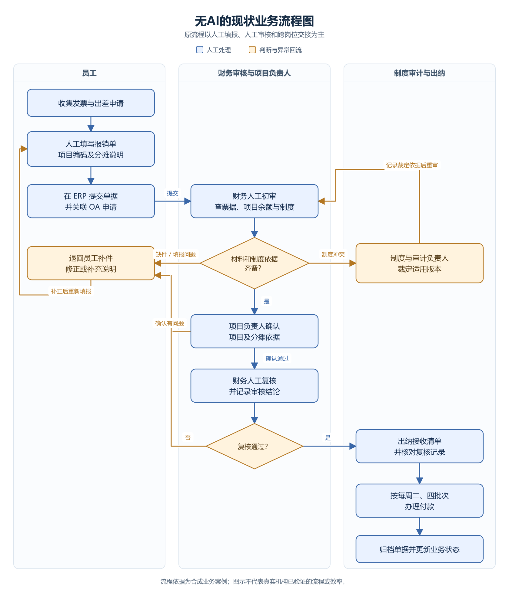
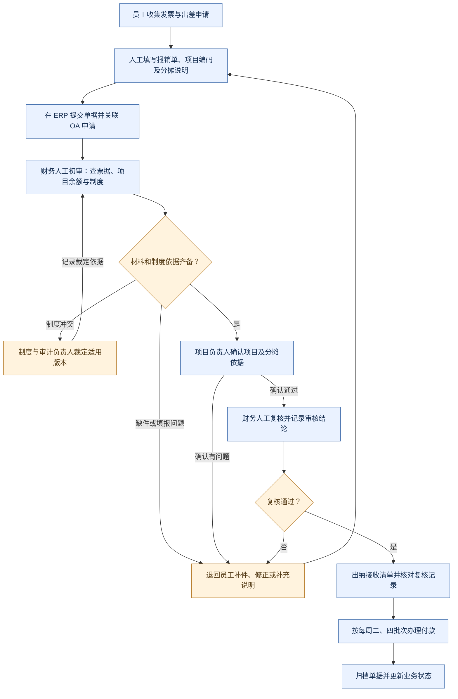
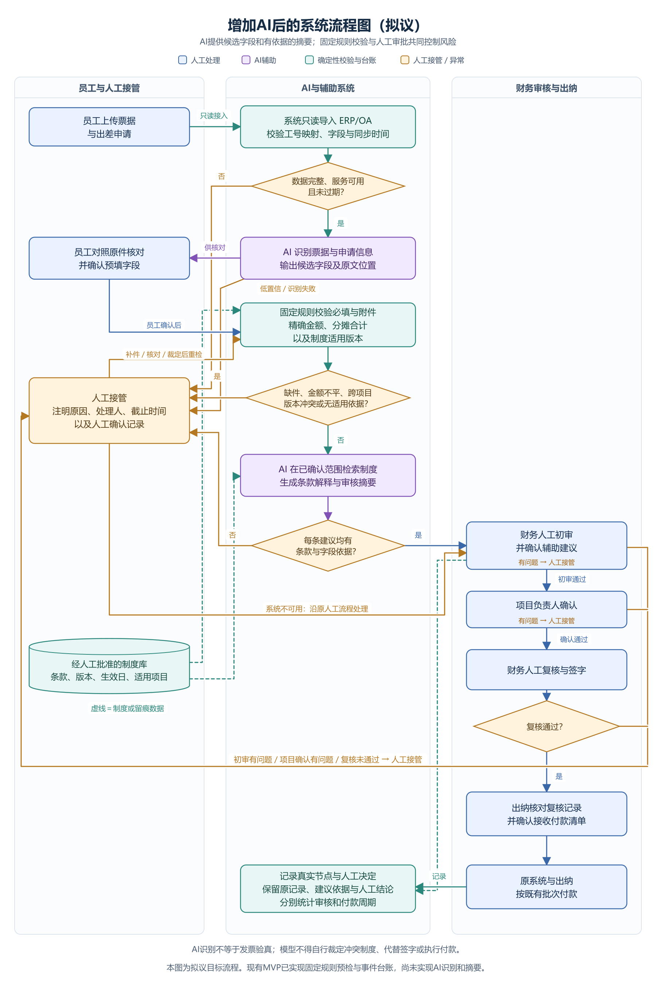
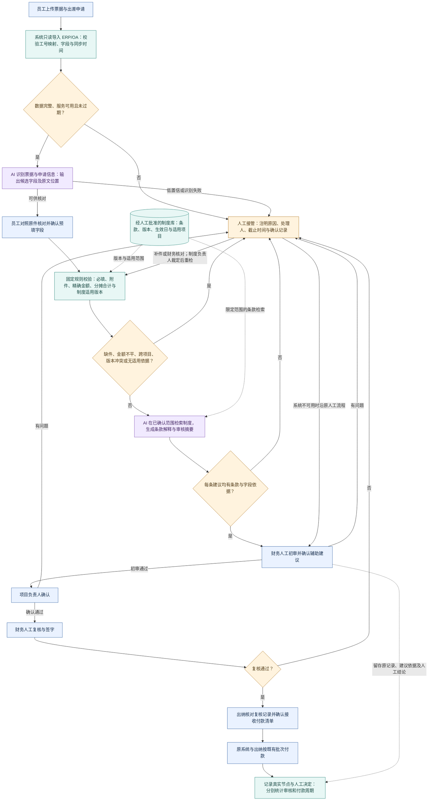

# 差旅报销辅助工具设计方案

## 目的与证据范围

本项目针对合成业务材料中的反复补件、跨项目分摊、制度版本冲突及节点等待不可见问题，建立可运行的离线验证工具。原材料为2026年10月29日生成的澄岳研究院业务需求发现报告，组织、角色和业务数据均为教学场景，需求仍需真实试点验证。

方案保留既有 ERP/OA 及人工审批责任，以提交前检查和事件台账补充信息。当前交付是命令行 MVP，不是已接入生产的报销平台。行业与开源比较见 [行业报告](industry-report.docx)及[引用资料](references.md)。

## 图1：没有 AI 的现状业务流程图

现状来自合成访谈：员工手工填报，财务人工查票据、项目余额与制度，项目负责人确认后再由财务复核、出纳付款。初审每日两次批处理，付款每周二、四批处理；制度争议由制度与审计负责人裁定。现状图中没有 AI 处理节点。

[PNG 图片](diagrams/as-is-no-ai.png) · [SVG 矢量图](diagrams/as-is-no-ai.svg) · [Mermaid 源文件](diagrams/as-is-no-ai.mmd)

查看可编辑的 Mermaid 流程

主要问题是手工录入和反复补件、制度说明分散，以及节点等待不可见。加快初审不一定缩短付款批次等待。

## 图2：增加 AI 后的系统流程图（拟议）

第二张图描述后续 AI 辅助系统的目标流程。AI 负责信息识别、限定范围的制度检索和带依据的摘要；固定规则负责金额、必填项和制度适用范围；人工承担数据确认、制度裁定、审批签字和付款。

[PNG 图片](diagrams/to-be-with-ai.png) · [SVG 矢量图](diagrams/to-be-with-ai.svg) · [Mermaid 源文件](diagrams/to-be-with-ai.mmd)

查看可编辑的 Mermaid 流程

### AI 与固定规则、人工的分工

| 处理方 | 具体输入与输出 | 确认与异常处理 |
|---|---|---|
| AI 信息识别 | 从票据与申请提取候选字段，返回原文位置供核对 | 员工对照原件确认；低置信或识别失败转人工；识别不等于发票验真 |
| 固定规则 | 精确计算金额与分摊总额，检查字段、附件声明和已批准制度的生效范围 | 缺件、金额不平、跨项目或版本冲突先转人工；不让 AI 自选冲突制度 |
| AI 制度检索与摘要 | 仅使用已确认适用范围内的批准条款，输出条款解释、审核摘要与引用 | 每条建议须对应原单字段和条款版本；找不到依据则停止建议并转人工 |
| 人工审批与付款 | 财务初审、项目确认、财务复核签字、出纳接手与付款 | 按原职责执行；辅助建议不能作为签核或付款指令 |
| 事件台账 | 保留实际节点、原始记录、建议依据、人工结论与接手确认 | 分开统计审核和付款周期；未发生或未记录的事件保持缺失 |

人工接管须注明原因、处理人、截止时间与确认时间。补件或制度裁定后重新检查；关键系统不可用时，直接沿原人工流程继续，避免必须经过 AI 才能报销。已有补件、分摊或制度争议尚未解决时，只显示问题清单，不生成可审核的自动结论。识别阈值、允许预填字段和模型服务须在试点中确定。

**实现状态：** 当前仓库已实现固定规则预检、CSV 导入和本地事件台账。图2中的 AI 识别、制度检索生成、登录授权、真实 ERP/OA 接口、在线人工接管和通知等均为拟建设能力。两张图用于对照现状与目标，不表示 AI 已在当前 MVP 中运行。后续试点费用见[示例报价单](quotation.md)。

## MVP 组件

| 组件 | 当前职责 | 不承担的职责 |
|---|---|---|
| `check` | 检查单据、附件声明、金额分摊与制度适用信息 | 税务验真、真实附件鉴定、自动签核 |
| `import-events` | 校验并原子导入带时区的 CSV 事件，处理重复和冲突 | 写回 ERP/OA、补造缺失事件 |
| `timeline` | 按事件时间展示单据实际记录的节点 | 从当前状态反推从未记录的审批 |
| `metrics` | 根据已有事件计算可确定的时间间隔 | 承诺3天到账、推断未发生的付款 |
| JSON 配置 | 保存演示制度和检查所需数据 | 替代正式制度审签及其归档系统 |
| SQLite 台账 | 保存本地事件，便于重放与查询 | 生产级防篡改审计和多租户服务 |

业务逻辑与 CLI 入口分开，方便后续测试和替换交互层。金额使用精确十进制语义；事件时间必须包含时区，存入台账前统一为 UTC，再按事件发生时间排序。当前台账保存来源和来源版本，尚未实现完整方案中的接收时间、操作人和防篡改审计日志。

## 核心规则

**提交前检查。** 缺少必填字段或要求的附件声明时输出问题清单，不把单据当成已完成正式提交。分摊合计必须与对应金额一致；算术通过不能证明分摊合理或已经获批。

**制度与人工确认。** 规则应具备版本、有效期、适用范围及批准状态。对跨项目分摊、制度冲突或缺失依据保留人工处理结论，不能简单选择“最新版本”替代制度裁定。示例中的批准状态是测试数据，不是本工具替组织完成审批。

**导入一致性。** 一次 CSV 导入作为整体处理。事件键为 `(source, event_id)`，即来源与事件标识的组合。同一事件键和规范化后的内容重复导入应保持幂等；同一键对应不同内容应拒绝导入，避免悄悄覆盖历史。错误文件不能只导入一部分后宣称成功。

**状态真实性。** 台账只记录明确发生的事件。“补交”不等于“复核通过”，“初审通过”不等于“可以付款”。缺少周期起点或终点时保留未知，不使用当前时间假装完成时间。

**权限边界。** 本地 CLI 不实现身份认证，因此不能拿它证明组织角色隔离已经成立。原方案中的项目授权、脱敏、人工签核和接手确认需在后续正式系统中实现并验证。

## 验收场景

| 场景 | 应观察的结果 |
|---|---|
| 普通合成单据字段齐备 | 输出检查结果，且不宣称发票真实或已获付款批准 |
| 缺发票或出差申请声明 | 标出具体缺件，供提交人补充 |
| 分摊合计不平 | 输出金额问题，不能按正常单据处理 |
| 多项目分摊或制度冲突 | 明确提示人工确认，不自动裁定争议 |
| 相同事件重复导入 | 不重复生成时间线节点 |
| 相同来源与事件标识但内容冲突 | 整次导入失败，原有台账保持一致 |
| 事件乱序输入 | 按事件时间重建顺序，不按文件行序猜测业务顺序 |
| 缺复核或付款节点 | 对应周期保持不可确定，不补造事件 |

运行测试命令及演示命令见 [README](../README.md)。验收记录应填写实际结果；本文件不预先宣称测试通过数量或真实效率收益。

`metrics` 使用首次明确记录的提交、复核通过和付款时间，输出自然时间小时数。它不计算工作日、工时或节点排队时间，不拆分多轮报销。缺失或相互矛盾的节点返回空指标和问题说明；示例48小时审核与72小时付款仅用于演示。

## 试点与后续扩展

真实试点应从一个项目组的境内普通差旅开始，先完成制度裁定、字段样例核对和历史数据回放，再进行并行验证。辅助建议不能覆盖原记录，接口失败时继续原人工流程。

实施阶段可增加单点登录、只读 ERP/OA 适配、按角色和项目授权、正式审签及审计留存。部署这些能力前需明确接口权限与组织职责；当前版本未实现，也不以模拟数据替代真实联调结果。

案例38%补件率来自合成样本19/50，“低于15%”与“9天降至3天”是目标。评价时应分别记录审核完成和付款完成，明确自然日或工作日、样本范围和分母。排队时间缩短不能直接计入劳动工时节省。
